# kuma-agent

<p align="center">
  
</p>

Muse を頭脳にした、対話型の相棒エージェント。人格と記憶を持ち、
会話しながら道具を使って用事をこなす、個人専用のエージェントを
自分の手で作るためのプロジェクトです。

大事にしているのは、人格（誰として振る舞うかはファイルで決める）、
記憶（会話を越えて残る長期記憶）、そして対話が中心であること。
詳しい設計は [docs/DESIGN.md](docs/DESIGN.md) を参照してください。

## できること

### 会話と記憶

- **2 つの進め方**: 会話はひとつで用事を覚える「相棒モード」と、
  会話をスレッドごとに分ける「スレッドモード」から選べます
- **長期記憶**: 事実・好み・約束を長期記憶（MEMORY.md）に持ち、長い会話は自動で要約に圧縮されます。記憶が大きくなると、必要な分を検索して思い出します（何行目に書いてあるかまで分かります）。重なった内容は自動で整理され、手動で全体をまとめ直すこともできます（書き換え前には必ず控えが残ります）。さらに、1 日 1 回、会話の中から覚えるべきことを自動で抜き出して長期記憶に足します（`KUMA_MEMORY_EXTRACT=0` で止められます）
- **人格と記憶の編集**: Web UI の「人格・記憶」パネルから、人格ファイル（SOUL.md など）と長期記憶（MEMORY.md）を直接編集できます（反映は新しい会話から）
- **アバター**: クマの顔の画像は、「人格・記憶」パネルからアップロードして差し替えられます（PNG / JPEG / GIF / WebP / SVG、2MB まで）。候補をためて切り替えたり、既定の顔に戻したりもできます
- **過去の会話の検索**: 「前に話したあの件」を全セッションの会話記録から探せます
- **引用返信**: 過去の発話を指定して返信できます
- **作業中表示**: 応答を待つ間、「考え中」「ファイルを読んでいます」など、今している作業がアニメーション付きで表示されます

### 用事と先回り

- **用事の管理**: 話題ごとの用事を一覧に記録し、対話の冒頭で進行中の用事を思い出します
- **能動発信**: 進行中の用事があるときは、エージェントから先に声をかけます（1 日 1 回まで。用事が無ければ何もしません）。テナントごとに有効・無効を切り替えられます。用事に時刻を指定すれば、その時刻に知らせるリマインダーにもなります。「その話題は知らせないで」と言えば覚えて、以後その用事には触れません。夜間など静かにする時間帯も決められます。朝は「朝のまとめ」として、カレンダーをつないでいれば今日の予定も一緒に届きます（既定 7:30、`KUMA_BRIEFING_TIME` で変更できます）
- **定期ジョブ**: 「毎週月曜 9 時にニュースをまとめて」のような定期の仕事を登録できます。時刻が来ると別のエージェントが実行し、結果が会話に届きます
- **見張り**: 「このページが変わったら知らせて」のような見張りを登録できます。対象は Web ページの本文・Web 検索の結果・作業フォルダ内のファイルで、巡回が間隔ごとに変化を確認し、変わっていたら別のエージェントが変化の要点をまとめて会話に届けます（最初の確認は基準の記録だけで、知らせはしません）。届け方は見張りごとに選べます。既定は「その場で知らせる」で、「朝のまとめに寄せる」を選んだ見張りの変化はその場では届かず、翌朝の知らせ（朝のまとめ。まとめが無い日や作れなかった日は日報）でまとめて届きます。朝の知らせに入るのは古い順に最大 5 件で、入り切らなかった分は消えずに翌日以降へ回ります。「おまかせ」を選んだ見張りは、変化ごとに、その場で知らせるか朝のまとめに寄せるかを内容から判定します（判定できないときや迷ったときは、その場で知らせます。判定の理由は記録に残ります）

### 道具と作業

- **作業の手順**: 手順が複数ある作業では、エージェントが自分の作業手順を書き出して、進むたびに状態（未着手／進行中／停滞／完了／中止）を更新します。手順は会話ごとに保存され、会話が切り替わっても続きから再開できます。Web UI の「いまの状況」パネルで、いまの手順と進み具合を見られます。用事の一覧（利用者の頼み事）とは別物です
- **Web 検索と取得**: Web を検索し、ページ本文を読んで答えられます（内部のアドレスへの取得は安全のため止められます）
- **MCP 対応**: MCP（Model Context Protocol）のサーバーを道具として接続できます。運用者が設定したサーバーの道具が、組み込みの道具と並んで使えるようになります（API 系の頭脳のみ）。ブラウザ操作用のサーバーをつなげば、会話から Web サイトを開いて操作することもできます
- **手順書**: `skills/` フォルダに手順書（マークダウン）を置くと、関係する仕事のときに読んで従います。会話の中で新しい手順書を覚えさせることもできます。また、1 日に 1 回、裏側で新しい会話から「再利用できる手順」を自動で学習し、新しい手順書として保存します（既存の手順書を書き換えることはありません。覚えたことはフィードに残ります。止めたいときは環境変数 `KUMA_SKILL_LEARN=0`）
- **委任**: まとまった作業は、別のエージェント（子）に任せられます。子は別の会話として動き、結果だけが返ってきます。任せるときは型が選べます: 調べ役（読み取り専用の道具だけ）、計画役（道具を使わず計画だけを返す）、通常役（道具一式）。読み取りで済む仕事に、書き込みや実行の権限を持たせないための仕組みです
- **承認**: コマンド実行と MCP の道具は、実行前に人の承認を挟みます（テナントごとに無効化もできます）
- **選択肢での質問**: 進め方が答えで変わる分岐では、選択肢のカードで尋ねます（Web の会話画面にカードが出て、押すか文章で答えると会話が続きます。時間内に答えが無ければ文章での質問に切り替わります）
- **成果物**: 作ったファイルは成果物として渡せ、Web UI の「探す」タブからいつでも開いたりダウンロードしたりできます
- **小さな画面**: 会話の中で作った小さな画面（記録表やボードなどの HTML ページ）が、Web UI の「画面」タブに残ります。会話が終わっても消えず、開いて見たり、クマに頼んで中身を更新したりできます
- **画像生成**: 頼めば画像も作れます（生成には Gemini の API キーが必要です。作った画像は成果物として渡されます）

### 入出力と外部接続

- **ファイル添付**: 画像（png / jpg / gif / webp）と文書（PDF・テキスト系）、音声（mp3 / wav / m4a など）を発話に添付できます
- **音声入出力**: Web UI ではマイクで録音してそのまま送れます。返事には「読み上げ」ボタンがあり、ブラウザが声で読み上げます（音声をそのまま聞き取れるのは Gemini の頭脳だけですが、Gemini のキーがあれば、ほかの頭脳でも先に文字起こししてから渡せます）
- **Telegram / LINE 接続**: Telegram や LINE からも話しかけられます（運用者が Bot / 公式アカウントを用意した場合）

### 運用と管理

- **選べる頭脳**: 6 種の LLM バックエンドから選べます
- **使用量の見える化**: 頭脳の利用量（呼び出し回数とトークン数）を記録し、Web UI の「使用量」パネルと `kuma-agent usage` で確認できます（CLI 系の頭脳は回数のみ）
- **データの書き出しと復元**: ユーザーごとのデータを ZIP で書き出せます（Web UI の「書き出し」ボタン、`kuma-agent export`）。書き出した ZIP からデータの復元もできます（Web UI の「復元」ボタン、`kuma-agent import`。置き換え方式で、復元前に現在のデータの控えが自動で取られます）

## 使い方

```bash
pip install -e .
kuma-agent chat          # 対話を開始する（プレーンな対話ループ）
kuma-agent chat --tui    # ターミナル UI（curses）で対話する
kuma-agent web           # Web UI を http://127.0.0.1:8765 で起動する
```

### 頭脳を選ぶ

環境変数 `KUMA_LLM_PROVIDER` で選びます（既定は `muse`）。API キーは
環境変数からのみ読みます。モデルは `KUMA_LLM_MODEL` で上書きできます。

| 値 | 頭脳 | API キー |
|---|---|---|
| `muse` | Meta Model API（Muse） | `META_MODEL_API_KEY` |
| `claude` | Claude API | `ANTHROPIC_API_KEY` |
| `gemini` | Gemini API | `GEMINI_API_KEY` / `GOOGLE_API_KEY` |
| `claude-code` | Claude Code CLI | 不要（CLI のログインを使う） |
| `gemini-cli` | Gemini CLI | 不要（CLI のログインを使う） |
| `codex` | Codex CLI | 不要（CLI のログインを使う） |

CLI 系の頭脳（`claude-code` / `gemini-cli` / `codex`）では、道具の
実行は外部 CLI の側で行われます。kuma-agent 側の承認確認や道具の
制限は効かないので、その前提で選んでください。Codex のサンド
ボックスは `KUMA_CODEX_SANDBOX` で指定できます（既定は
`workspace-write`。`read-only` にすると読み取りだけになります）。
CLI へ渡す追加の引数は `KUMA_CLI_EXTRA_ARGS`（空白区切り、全 CLI
共通）で指定できます。指定できる引数は導入先の CLI のバージョン
によるので、CLI のヘルプで確認してから入れてください。

#### テナントごとの頭脳（0.81.0〜0.83.0）

頭脳は基本的に全体で共通ですが、テナントごとに別の頭脳を使う
こともできます（第1段: プロバイダとモデル名、API 系のみ）。
Web UI の「管理」タブのテナント一覧で、テナントごとに頭脳の
種類とモデル名を指定できます。指定しないテナントは全体の既定
（環境変数）に従います。保存すると、そのテナントの会話は新しい
頭脳で作り直され、すぐに反映されます（会話の記録は残ります）。
巡回や朝のまとめ、委任の子といった裏側の処理も、そのテナントの
頭脳で行われます。画面上部の頭脳の表示と CLI 系の注意書きも、
表示中のテナントの頭脳に合わせて切り替わります。

API キーもテナントごとに分けられます（0.82.0、第2段）。管理
タブのテナント行でキーを入力すると、そのテナント専用のキー
として保存され、全体のキーより優先して使われます。キーだけを
変えた場合も、保存するとすぐに反映されます。画面にはキーの値
は表示されず、設定済みかどうかと対象のプロバイダだけが出ます。
キーはテナントの置き場の専用ファイル（`brain/credentials.json`）
に保存され、データの書き出しや控えには含まれません。復元で
書き戻されることもありません（既存のキーがそのまま残ります）。
頭脳とモデル名の設定はデータ置き場の `settings.json` に保存
されます（秘密情報は含まれません）。CLI（`kuma-agent chat`
など）は、自分のテナント（`KUMA_TENANT`）の指定に従います。

CLI 系の頭脳もテナントごとに指定できます（0.83.0、第3段）。
ただし、CLI 系では道具の実行が外部 CLI の側で行われ、
kuma-agent 側の承認確認や道具の制限は効かないため、画面の
操作だけでは指定できないようにしてあります。運用者が環境
変数 `KUMA_ALLOW_TENANT_BRAIN_CLI=1` を設定したときだけ、
管理タブの頭脳の選択肢に CLI 系が現れます。スイッチを入れる
と、起動時の注意にもその旨が出ます。頭脳の表示と CLI 系の
注意書きは、表示中のテナントの実効頭脳に合わせて出ます
（CLI 系のテナントだけに注意が出ます）。Codex のサンド
ボックス（`KUMA_CODEX_SANDBOX`）と CLI へ渡す追加の引数
（`KUMA_CLI_EXTRA_ARGS`）は、テナント別ではなく全体共通の
ままです。

### モードを選ぶ

環境変数 `KUMA_MODE`、または `chat` / `web` の `--mode` で選びます。

- **相棒モード**（`ledger`、既定）: 会話はひとつ。抱えている用事を覚えていて、一緒に進めます。部屋は 1 つに固定され、Web UI では部屋の選択自体が出ません
- **スレッドモード**（`wall`）: 会話をスレッドごとに分けて、それぞれ独立に進めます。用事の管理は行わず、話題の切り替えはスレッドの切り替えだけで行います

引用返信は、Web UI では各発話の「引用」ボタン、TUI では
`/quote <番号>` を使います。添付は、Web UI では「添付」ボタンか
画面へのドラッグ＆ドロップ、TUI では `/attach <パス>` です。

## 画面イメージ

どちらの画面からも、画像や文書（PDF・テキスト）を添付して送れます。

### Web UI（`kuma-agent web`）

入力欄の「添付」ボタンか、画面へのドラッグ＆ドロップでファイルを選べます。

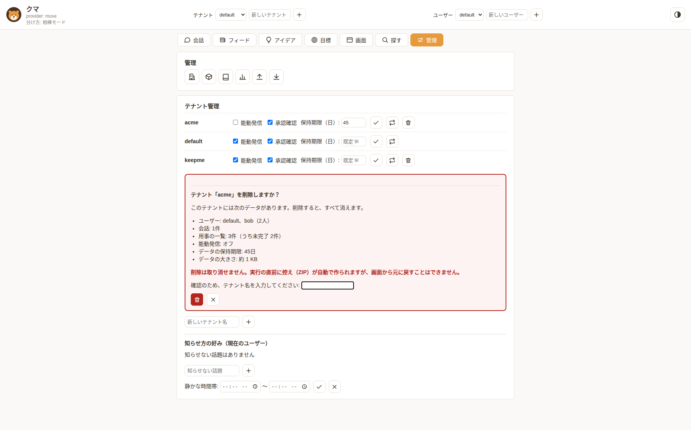

操作動画（ドラッグ＆ドロップで写真を添付しています）:


テーマごとの画面（同じ会話を、各テーマの PC／スマホで表示）:

| テーマ | PC | スマホ |
| --- | --- | --- |
| 昼 | 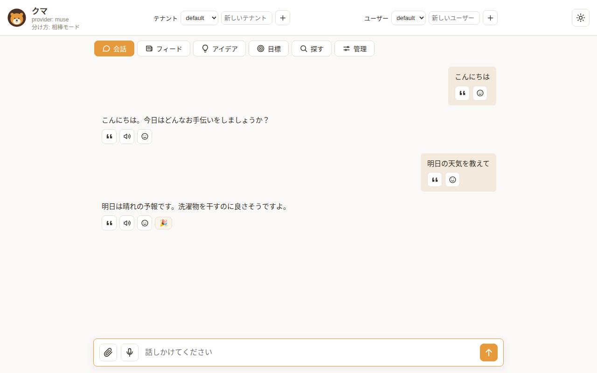 | 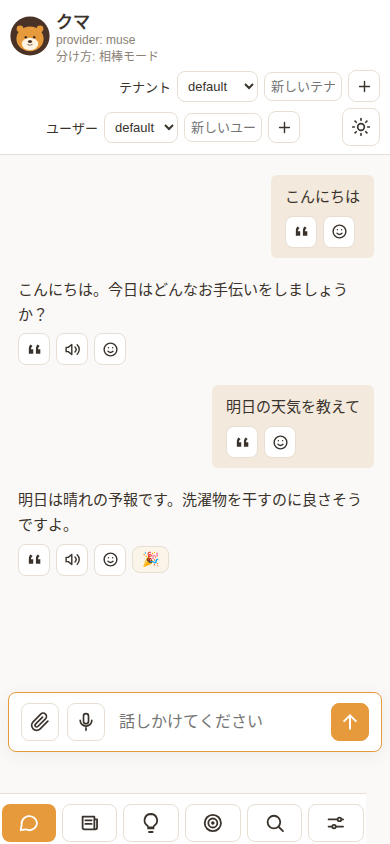 |
| 夜 | 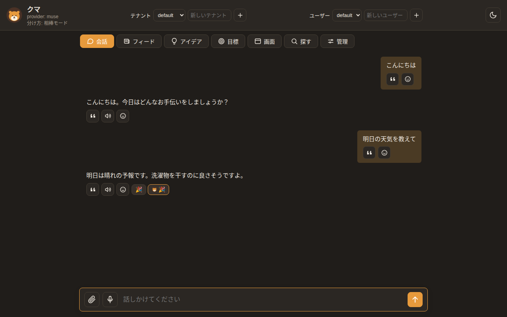 | 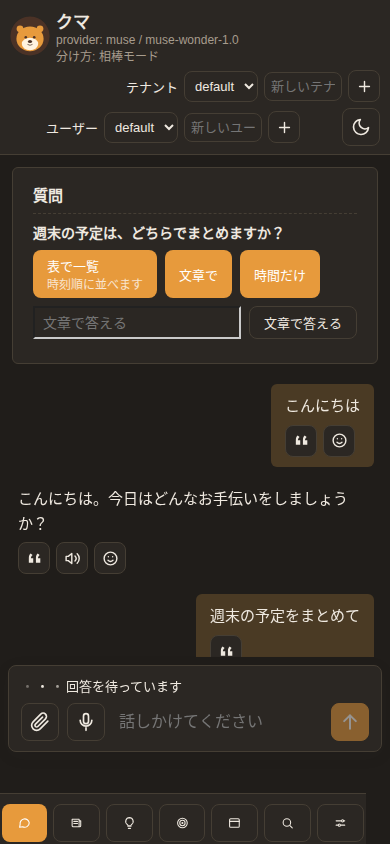 |
| システム（端末が夜の設定のとき） | 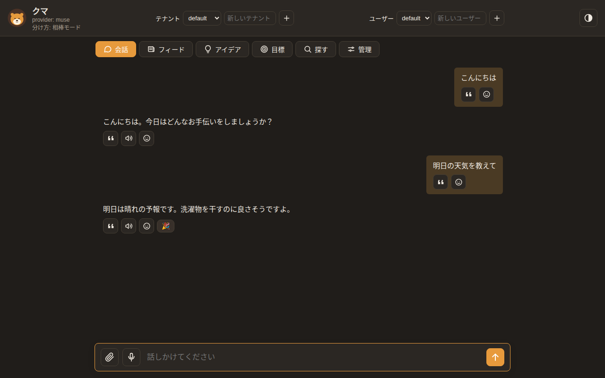 | 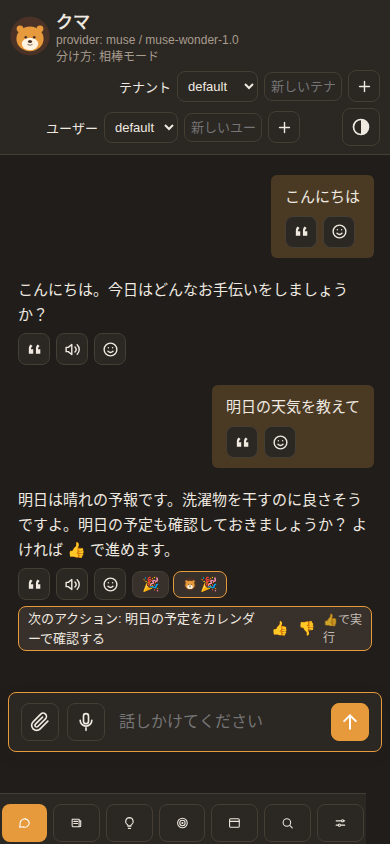 |
| 8ビット（インベーダーゲーム風） | 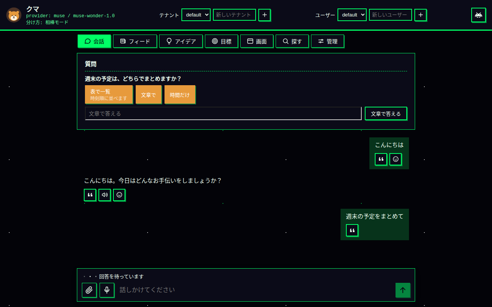 | 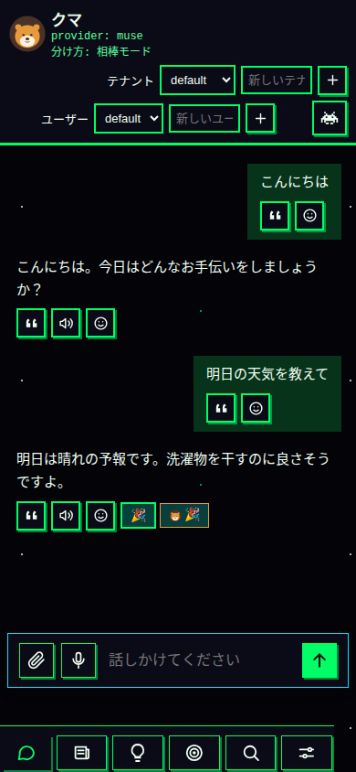 |

8ビットモードの操作動画（PC）:

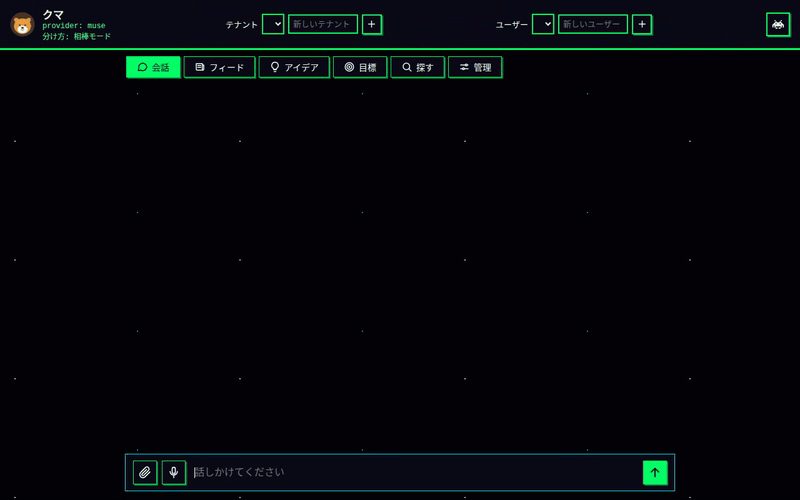

8ビットモードの操作動画（スマホ）:

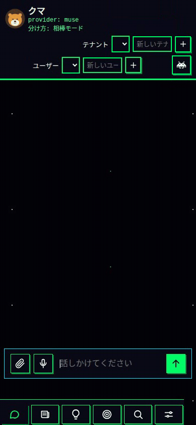

### TUI（`kuma-agent chat --tui`）

`/attach <パス>` で添付します。

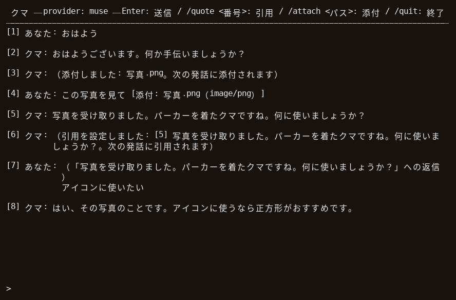

操作動画（`/attach` で写真を添付しています）:

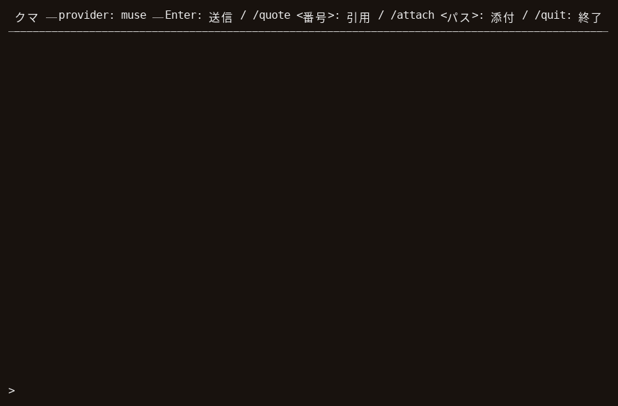

## 運用と設定

データの区切りは「テナント ＞ ユーザー」の階層で、その内側に
用事の一覧やスレッドが置かれます。運用の詳細は
[docs/DESIGN.md](docs/DESIGN.md) を参照してください。

### テナントとユーザー

- **テナント**: データ全体の大きな区切りです。テナントごとに人格・長期記憶・スレッド・用事の記録がすべて分かれます（`--tenant <名前>`、環境変数 `KUMA_TENANT`、既定は `default`）。Web UI では画面上部で切り替えます
- **テナントの管理**: Web UI の「管理」タブの「テナント管理」から、テナントの新規作成、テナントごとの能動発信の有効・無効、保持期限（日数）の変更、削除ができます（削除の前には、消えるデータの内訳（ユーザー・会話・用事の件数と、能動発信・保持期限の設定）を画面に表示して確認します。実行の直前に控えがデータ置き場の `backups/` に残ります。既定のテナントは削除できません）。能動発信の設定はデータ置き場の `settings.json` に保存されます
- **画面のテーマ**: Web UI の見た目は「昼」「夜」「システム（端末の設定に合わせる）」「8ビット（インベーダーゲーム風）」から選べます（ヘッダー右上のアイコンボタン。押すたびに切り替わり、いまのテーマのアイコンが出ます）。選んだ内容はブラウザに覚えられます。スマホ幅では下部のタブはアイコンだけの表示になります
- **タブと状況表示**: Web UI はタブ方式です（会話／フィード／アイデア／目標／画面／探す／管理）。ヘッダーのアバターを押すと「いまの状況」が開き、状態・用事の件数・作業の手順・承認待ち・使用量をまとめて見られます。ボタンはアイコン表示で、スマホではタブバーが画面の下に並びます
- **リアクション**: Web UI では、発話に絵文字のリアクション（👍 ❤️ 😂 😮 🎉 🙏）を付けられます。発話の顔アイコンから選び、付いた絵文字を押すと外れます。付けた内容は保存され、開き直しても残ります
- **ユーザー**: テナントの下の区切りです。同じテナントでもユーザーごとに文脈は混ざりません（`--user <名前>`、環境変数 `KUMA_USER`、既定は `default`）。指定しなければ既定ユーザーのまま単一ユーザー運用です。識別は宣言によるもので、認証ではありません

### 保持期限と掃除

コンテナ等のサービス運用では利用者がデータを消せないため、記録には
保持期限があります（`KUMA_RETENTION_DAYS`、既定 90 日、0 で無期限）。
期限を過ぎたスレッドの記録と完了した用事は、Web サーバーの起動時に
自動で掃除されます。長期記憶と人格ファイルは対象外です。

- 運用者は `kuma-agent cleanup` でも実行できます（`--dry-run` で件数だけ確認、`--tenant <名前>` で対象を限定、`--days <日数>` でその場限りの上書き）
- テナントごとに期間を変える場合は、データ置き場の `retention.json` に `{"tenants": {"<テナント名>": <日数>}}` と書きます（優先順位は `--days` ＞ `retention.json` ＞ 全体の既定）

スレッドの管理は、Web UI（スレッドモード時）のほか、運用者向けに `kuma-agent threads`（一覧）と `kuma-agent threads --delete <名前>`（記録だけを削除）でもできます。

そのほかの運用者向けコマンドに、`kuma-agent jobs`（定期ジョブの一覧）、`kuma-agent outputs`（成果物の一覧）、`kuma-agent usage`（使用量）、`kuma-agent export`（データの書き出し）、`kuma-agent import`（データの復元）、`kuma-agent search-history <語句>`（過去の会話の検索）、`kuma-agent memory-search <語句>`（長期記憶の検索）、`kuma-agent memory-tidy`（長期記憶の整理。`--dry-run` で提案だけ作れます）、`kuma-agent memory-extract`（会話からの記憶の抽出を手動で実行。`--dry-run` で提案だけ表示できます）があります。

### MCP サーバー（道具の追加）

データ置き場の `mcp.json` にサーバーを列挙すると、その道具が使えるようになります。つなぎ方は stdio（サーバーを子プロセスとして起動）で、道具名は `サーバー名__道具名` になります。テナントの置き場に `mcp.json` を置くと、そのテナントではそちらだけが使われます（設定の反映には再起動が必要です）。

```json
{"servers": [{"name": "example", "command": "mcp-server-example", "args": [], "env": {}}]}
```

たとえば、ブラウザを操作するサーバー（Microsoft の Playwright MCP）をつなぐと、会話から Web サイトを開いたり、ボタンを押したり、文字を入力したりできます。

```json
{"servers": [{"name": "browser", "command": "npx", "args": ["-y", "@playwright/mcp@<版番号>", "--headless"], "env": {}}]}
```

（`<版番号>` は使う版に置き換えてください。つなぎ方の注意点は [docs/DESIGN.md](docs/DESIGN.md) の「MCP 対応」にあります）

Google カレンダーをつなぐこともできます。会話から予定を聞いたり、新しい予定を入れたり、空いている時間を確認したりできるようになります。準備として、Google Cloud の画面でカレンダー API を使う許可を取り、認証用のファイルを用意する必要があります（初回だけ、ブラウザで Google にサインインします）。設定の例と手順は [docs/DESIGN.md](docs/DESIGN.md) の「MCP 対応」にあります。

MCP サーバーは任意のプログラムを実行することと同義です。設定できるのは運用者だけにしてください。

### Telegram からの接続

Telegram の Bot（@BotFather で発行）を通じて会話できます。環境変数 `KUMA_TELEGRAM_BOT_TOKEN` にトークンを設定すると、`kuma-agent web` の起動中に届いたメッセージを処理します（Web なしでは `kuma-agent telegram` で単独実行できます）。

安全のため、会話を処理するのは `KUMA_TELEGRAM_ALLOWED_CHATS` に登録したチャットだけです。未登録のチャットには、登録に必要な chat id の案内だけが返ります。対象のテナント・ユーザーは `KUMA_TELEGRAM_TENANT` / `KUMA_TELEGRAM_USER` で指定します。今はテキストのみ対応です。

また、能動発信（日報・リマインダー・定期ジョブの結果）は、対象ユーザーの分が許可リストのチャットにも届きます（`KUMA_TELEGRAM_PROACTIVE=0` で止められます）。

### LINE からの接続

LINE 公式アカウント（Messaging API）を通じて会話できます。Telegram と違い、LINE のサーバーから届く Webhook で受け取る方式なので、**`kuma-agent web` を公開 HTTPS で外から届く場所に置く必要があります**。

運用者の準備は次のとおりです:

1. [LINE Developers](https://developers.line.biz/) で Messaging API チャネルを作り、チャネルシークレットとチャネルアクセストークン（長期）を発行する
2. 環境変数 `KUMA_LINE_CHANNEL_SECRET` と `KUMA_LINE_CHANNEL_ACCESS_TOKEN` に設定する
3. LINE Developers の Webhook URL に `https://<公開先>/line/webhook` を登録する
4. LINE Official Account Manager で Webhook を有効にし、応答メッセージなどの自動応答を切る

安全のため、会話を処理するのは `KUMA_LINE_ALLOWED_USERS` に登録したユーザーだけです。未登録のユーザーには、登録に必要な user id の案内だけが返ります。対象のテナント・ユーザーは `KUMA_LINE_TENANT` / `KUMA_LINE_USER` で指定します。今はテキストと 1 対 1 の会話のみ対応です（グループ・ルームは未対応）。

能動発信も許可リストのユーザーに届きます（`KUMA_LINE_PROACTIVE=0` で止められます）。能動発信は Push 送信で、月間の送信通数に数えられます。

### Google カレンダーの読み取り連携

Google カレンダーの予定を、読み取りだけに使うための連携です（予定の作成・変更・削除はできません）。準備は運用者が行います。認可まで済ませたら `kuma-agent google-calendar status` で接続を確認できます。会話から予定を読む道具と、朝のまとめへの反映があります。

1. [Google Cloud コンソール](https://console.cloud.google.com/)でプロジェクトを用意する（既存のものでも構いません）
2. 「API とサービス」→「ライブラリ」で **Google Calendar API を有効化**する
3. 「OAuth 同意画面」を設定し、公開ステータスを **「本番」に進める**（テストのままだと、許可が 7 日で切れてしまいます）
4. 「認証情報」で **OAuth クライアント ID（種類: デスクトップアプリ）** を作り、設定ファイル（JSON）をダウンロードする
5. ダウンロードしたファイルを、kuma-agent のプロセスだけが読める場所に置き、環境変数 `KUMA_GOOGLE_CALENDAR_CLIENT_SECRETS_FILE` にそのパスを設定する（このファイルをリポジトリやデータの書き出しに入れないこと）
6. 対象のテナント・ユーザーで認可を実行する: `kuma-agent google-calendar auth --tenant <名前> --user <名前>`。ブラウザで Google の認可画面が開くので、対象のアカウントでサインインし、予定とカレンダー一覧の読み取りを許可する
7. `kuma-agent google-calendar status` で「接続済みです」と出れば完了です

対象にするカレンダーは、既定では主カレンダーだけです。ほかのカレンダー（仕事用・家族の共有など）も対象にするには、`kuma-agent google-calendar calendars` で一覧を確かめ、`kuma-agent google-calendar select <番号...>` で選びます。選んだカレンダーの予定は、朝のまとめと会話の道具で時刻順にまとめて扱われます。以前の版で認可した場合は、一覧を読むための許可が足りないため、`kuma-agent google-calendar auth` を再実行して許可をやり直してください（再認可で追加されます）。

認可の情報は利用者ごとに、その利用者のデータ置き場の `google-calendar/credentials.json` に保存されます。データの書き出しや控えには含まれないため、別の環境へデータを移した場合は、移した先で認可をやり直してください。連携をやめるときは `kuma-agent google-calendar revoke` で資格情報を削除できます（Google アカウント側の許可も消したい場合は、Google アカウントの「サードパーティによるアクセス」からも削除してください）。コンテナで動かしている場合は、認可はホスト側でデータ置き場を指定して実行し、できた資格情報ファイルをボリューム内の対象ユーザーの置き場へ置くのが実用的です。

### 添付の渡し方

添付できるのは画像（png / jpg / gif / webp）と文書（PDF、.txt /
.md / .csv / .json など）と音声（mp3 / wav / m4a / ogg / webm）で、
1 件の上限は 10MB です。テキストとして
読める文書は、どの頭脳でも本文がそのまま渡ります。会話ログには
添付そのものではなく「[添付: 名前（種別）]」の要約だけが残ります。

| 頭脳 | 画像 | PDF | 音声 |
|---|---|---|---|
| Claude API | 画像として渡す | 文書として渡す | 渡さず「添付あり」の表示だけ伝える |
| Gemini API | データとして渡す | データとして渡す | データとして渡す |
| Meta Model API（Muse） | 画像として渡す | 渡さず「添付あり」の表示だけ伝える | 渡さず「添付あり」の表示だけ伝える |
| CLI 系（Claude Code / Gemini CLI / Codex） | 作業フォルダの `.kuma-attachments/` に置き、相手が自分で読む | 同左 | 同左 |

### 主な環境変数

| 環境変数 | 意味 | 既定 |
|---|---|---|
| `KUMA_LLM_PROVIDER` | 頭脳の選択 | `muse` |
| `KUMA_LLM_MODEL` | モデルの上書き | 頭脳ごとの既定 |
| `KUMA_DATA_DIR` | データの置き場 | `data` |
| `KUMA_TENANT` | テナント名 | `default` |
| `KUMA_USER` | ユーザー名 | `default` |
| `KUMA_MODE` | モード（`ledger` / `wall`） | `ledger`（相棒モード） |
| `KUMA_RETENTION_DAYS` | 保持期限（日） | `90`（0 で無期限） |
| `KUMA_PROACTIVE_INTERVAL_SECONDS` | 能動発信のチェック間隔（秒） | `300` |
| `KUMA_MCP_TIMEOUT_SECONDS` | MCP サーバーの応答待ち（秒） | `60` |
| `KUMA_APPROVAL_TIMEOUT_SECONDS` | 承認待ちの上限（秒） | `300` |
| `KUMA_MEMORY_FULL_INJECT_CHARS` | 長期記憶を全文読み込む上限（文字） | `6000` |
| `KUMA_DELEGATE_MODEL` | 委任先エージェントの頭脳 | （親と同じ） |
| `KUMA_DELEGATE_TIMEOUT_SECONDS` | 委任の上限（秒） | `600` |
| `KUMA_COMPACT_AFTER_MESSAGES` | 要約圧縮を始める発話数 | `40`（0 で無効） |
| `KUMA_COMPACT_KEEP_MESSAGES` | 圧縮時に残す直近の発話数 | `10` |
| `KUMA_SEARCH_URL` | Web 検索の宛先（`{query}` を含む URL） | DuckDuckGo |
| `KUMA_FETCH_ALLOW_PRIVATE` | ページ取得で内部アドレスを許可するか | （無効） |
| `KUMA_TELEGRAM_BOT_TOKEN` | Telegram Bot のトークン | （未設定＝無効） |
| `KUMA_TELEGRAM_ALLOWED_CHATS` | 会話を許可する chat id（カンマ区切り） | （無し＝処理しない） |
| `KUMA_TELEGRAM_TENANT` / `KUMA_TELEGRAM_USER` | Telegram の会話の行き先 | `default` / `default` |
| `KUMA_TELEGRAM_PROACTIVE` | 能動発信を Telegram にも届けるか（`0` で止める） | （届ける） |
| `KUMA_LINE_CHANNEL_SECRET` / `KUMA_LINE_CHANNEL_ACCESS_TOKEN` | LINE のチャネルシークレットとアクセストークン | （未設定＝無効） |
| `KUMA_LINE_ALLOWED_USERS` | 会話を許可する user id（カンマ区切り） | （無し＝処理しない） |
| `KUMA_LINE_TENANT` / `KUMA_LINE_USER` | LINE の会話の行き先 | `default` / `default` |
| `KUMA_LINE_PROACTIVE` | 能動発信を LINE にも届けるか（`0` で止める） | （届ける） |
| `KUMA_GOOGLE_CALENDAR_CLIENT_SECRETS_FILE` | Google カレンダー連携の OAuth クライアント設定ファイルへのパス | （未設定＝連携なし） |
| `KUMA_GOOGLE_CALENDAR` | Google カレンダー連携をするか（`0` で止める） | （する） |
| `KUMA_BRIEFING_TIME` | 朝のまとめの時刻（`off` で無効） | `07:30` |
| `KUMA_NOTIFICATION_TRIAGE` | 見張りの届け方の振り分け（`0` で止めて全てその場で知らせる。既に朝へ寄せた分は止めている間も朝の知らせで届く） | （する） |
| `KUMA_MEMORY_EXTRACT` | 会話から長期記憶への自動抽出（`0` で止める） | （する） |
| `KUMA_WEB_PASSWORD` | Web UI のログインパスワード | （未設定＝ログインなし） |
| `KUMA_WEB_SECURE_COOKIE` | ログイン Cookie に Secure を付けるか（`1` で有効） | （無効） |
| `KUMA_IMAGE_MODEL` | 画像生成に使うモデル | `gemini-3.8-flash-image` |
| `KUMA_TRANSCRIBE` | 音声の文字起こしをするか（`0` で止める） | （する） |
| `KUMA_TRANSCRIBE_MODEL` | 文字起こしに使うモデル | Gemini の既定モデル |

### コンテナで動かす

Docker でサービスとして動かせます。リポジトリの `Dockerfile` と `docker-compose.yml` を使う場合:

```bash
cp .env.example .env   # .env に頭脳と API キーを書く
docker compose up -d --build
```

ブラウザで http://127.0.0.1:8765 を開きます。データは名前付きボリューム（`kuma-data`）の `/data` に保存されるので、コンテナを作り直しても長期記憶や用事は残ります。API キーが未設定だと起動直後に終了するので、`.env` を先に用意してください。頭脳は API 系（muse / claude / gemini）から選んでください（CLI 系の頭脳はコンテナ内では使えません）。

コンテナでも、ブラウザ操作と Google カレンダーの MCP サーバーが使えます（イメージに Node.js と Chromium が入っています）。設定は `/data/mcp.json` に書き、コマンド名は `playwright-mcp` / `google-calendar-mcp` を使います。詳しくは DESIGN.md の「ブラウザ操作」「実サービスの接続例」のコンテナ向け設定例を見てください。

### 外から試す（Cloudflare トンネル）

スマホなど外のネットワークから試したいときは、Cloudflare の Quick Tunnel で一時的な公開 URL を作れます（アカウント不要）。公開 URL はだれでも開けるため、先に `.env` へ `KUMA_WEB_PASSWORD` を設定して、ログインを有効にしてください。

```bash
docker compose --profile tunnel up -d --build
docker compose logs cloudflared   # https://〜.trycloudflare.com の URL を確認
```

公開するときの前提:

- 公開の形は、このコンテナ＋トンネルが想定です。ホスト側のポートはこの PC からだけ届くよう絞ってあるので、外からはトンネル経由でのみ開けます。
- `KUMA_WEB_PASSWORD` の設定が前提です。あわせて `.env` の `KUMA_WEB_SECURE_COOKIE=1` も有効にしてください（HTTPS で公開するときにログインの Cookie を守るため）。
- ログインは画面全体への入口の守りです。ログインできる人は、画面の切り替えで全テナント・全ユーザー分のデータ（用事や会話、長期記憶など）に届きます。人ごとに分けられる前提ではないので、パスワードは信頼できる相手の範囲にだけ渡してください。
- 公開する画面を 1 つのテナント／ユーザーだけに絞りたいときは、`.env` の `KUMA_WEB_TENANT` / `KUMA_WEB_USER` を設定してください（どちらか片方だけでも構いません）。その組み合わせ以外へのアクセスはエラー（403）になり、一覧にも固定した分だけが出ます。設定しなければ従来どおり切り替えられます。
- CLI 系の頭脳はこのコンテナでは使えません。ホストへ直接入れた kuma-agent を外に出す場合は、道具の実行が外部 CLI の側で行われ、こちらの承認確認や道具の制限が効かない点を前提にしてください。

URL は起動のたびに変わります。止めるときは `docker compose --profile tunnel down` です。LINE の webhook の受け口にも使えますが、URL が変わるたびに LINE 側の登録も直す必要があります。固定の URL で続けたい場合は、Cloudflare のアカウントとドメインを使う名前付きトンネルか、逆プロキシを用意してください。

### Web UI の注意

Web UI は `--host` / `--port` で待ち受け先を変えられます。既定は
認証を持たない単一ユーザー前提の画面です。環境変数
`KUMA_WEB_PASSWORD` を設定すると、パスワードによるログインが
有効になります（未設定なら従来どおり認証なし）。それでも、
既定の 127.0.0.1 から外に出す場合は、信頼できる範囲に限るか、
HTTPS の逆プロキシの後ろに置くなど注意してください。外へ
公開するときの前提は「外から試す（Cloudflare トンネル）」の
節にまとめてあります。

## アバターとイメージカラー

アバターは、ココアブラウンのパーカーを着た若いクマ。大きく構えず、
近くにいて、頼れる相棒のイメージ。公式アバターは `assets/avatar.png`。
小さいサイズやファビコン用に、図形だけの簡略マーク
`assets/avatar.svg` も用意している。

| 役割 | 色 | コード | 由来 |
|---|---|---|---|
| メイン（毛色） | ハニーアンバー | `#E79A3C` | 蜂蜜の色。温かさと親しみ |
| 濃色（輪郭・背景） | ココアブラウン | `#4B3226` | クマの毛色と土の色。落ち着きと信頼 |
| 明色（口元・背景） | クリーム | `#FFF3E0` | やわらかい明るさ |
| アクセント | 若葉グリーン | `#7FB069` | 森の色。成長と新しさ |

- 迷ったらメインと濃色の 2 色で構成する（アバターがその基準形）
- アクセントはリンクや強調など、少量にだけ使う
- 背景はクリームを基本にし、白より少し温かい画面にする
